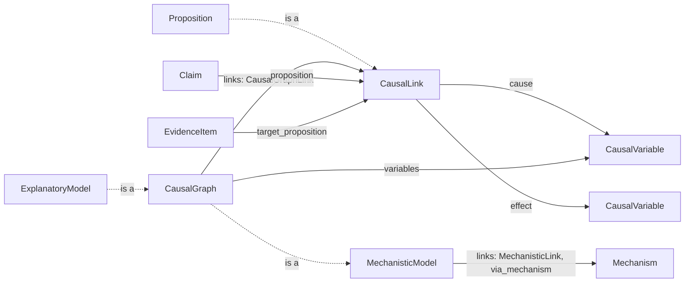

# Causality in DAPPER

**Status:** experimental, 0.3.0-a1. The classes live in `schema/claims.yaml`
(the scientific reasoning layer); `schema/mechanisms.yaml` builds biological
mechanisms on them, and `schema/dismech.yaml` maps DISMECH onto them.

## What "causes" means here

DAPPER uses one definition of causation throughout, the interventionist one:

> **X causes Y in context C** when some intervention that changed X, with
> other relevant variables held fixed, would change Y (its value or its
> distribution) in C.

This is the counterfactual account of Woodward (2003): the counterfactuals are
about interventions, stated for populations. Four commitments follow.

- **What is related are variables, not bare entities.** A variable is an
  entity together with the aspect of it that varies: CLCN5 *activity*,
  endosomal acidification *rate*, low-molecular-weight proteinuria
  *presence*. "CLCN5 causes Dent disease" is elliptical; what an intervention
  changes is CLCN5 activity. Loss of function is an intervention on that
  variable (setting it low), not part of the variable.
- **It holds in a context.** A dependence holds over some range of settings
  (ancestry, trait, tissue, cell type). That range is the proposition's
  `contexts` and `scope`.
- **It is general by default.** A causal proposition is about a population.
  "This variant caused this patient's disease" is a single-case
  counterfactual and is out of scope for now.
- **"Causal" belongs to content, never to evidence.** A proposition is causal
  because of what it says. A Mendelian randomization result does not make a
  proposition causal; it is evidence for one. How close the evidence comes to
  an intervention is recorded on the evidence (`EvidenceItem.evidence_design`).

The definition handles loss of function, which is causation by absence:
nothing is transmitted from an absent protein, but changing its activity
still changes the effect. It also fits how genetics argues, since knockouts and
CRISPR screens are interventions and loss-of-function carriers and Mendelian
randomization are natural experiments.

Variables in one causal graph must not be related by definition. Dent disease
is *defined* by its proximal-tubule dysfunction, so "proximal-tubule
dysfunction causes Dent disease" is not a causal link between distinct
variables. The [Dent example](#worked-example-dent-disease) ends at
low-molecular-weight proteinuria for that reason.

## Relation kinds

`Proposition.relation_kind` says what kind of dependence a proposition
asserts. Only `CAUSATION` carries the interventionist reading, and a
rendering uses causal language only for it.

| Value | Content | Example |
|---|---|---|
| `ASSOCIATION` | Co-variation, with no claim about interventions. | Gene A is associated with Trait T. |
| `PREDICTION` | Predicts under a stated model. | GeneSet B predicts trait-relevant genes for T. |
| `MEASUREMENT` | Reads out or indicates. | GeneSet B is a possible readout of Factor C. |
| `CONSTITUTION` | Is a component of the mechanism that makes up. | The CLC-5 exchanger is a component of the endosomal acidification machinery. |
| `CAUSATION` | Interventionist dependence. | CLCN5 activity increases endosomal acidification. |

`CAUSATION` close-matches RO's *causally related to* (`RO:0002410`).
Constitution is not causation: parts do not cause the wholes they make up.

## Classes



- **`CausalVariable`**: `description` (required), optional `entity` (a gene,
  process, cell type, phenotype or disease identifier) and `aspect` (what
  varies).
- **`CausalLink`**, a kind of `Proposition`: `cause`, `effect`, optional
  `effect_direction` (`INCREASES`, `DECREASES`, `CHANGES`; how raising the cause
  changes the effect) and the inherited `statement`, `contexts` and `scope`.
  `relation_kind` is always `CAUSATION`. Because a link is a Proposition,
  Claims assess it and EvidenceItems target it **one link at a time**.
  `INCREASES` and `DECREASES` close-match RO's *causally upstream of, positive
  effect* (`RO:0002304`) and *negative effect* (`RO:0002305`).
- **`CausalGraph`**, a kind of `ExplanatoryModel`: an explicit `variables`
  set, `links` (each a `CausalGraphLink`: the link, its `link_type`, and any
  `intermediates`), optional `has_feedback`, `contexts` and `scope`.
- **`MechanisticModel`** (mechanisms.yaml), a kind of `CausalGraph` whose
  links are `MechanisticLink`s that may name the `Mechanism`s carrying them
  out (`via_mechanism`). "Carried out by" is a part-whole relation, not a
  further causal step.

A Proposition, ScientificAccount or EvidenceItem refers to a graph through its
`explanatory_model` slot, which accepts any `ExplanatoryModel`.

## Directness is relative to a graph

An edge in a causal graph means the cause is a **direct cause of the effect
relative to the graph's variables**: no other variable in the graph lies
between them. So directness is not a property of the link. It is recorded on
the link's place in a graph (`CausalGraphLink.link_type`):

| `link_type` | Meaning in this graph |
|---|---|
| `DIRECT` | No omitted intermediates at this granularity. |
| `INDIRECT_KNOWN_INTERMEDIATES` | Known intermediates are left out; list them in `intermediates`. |
| `INDIRECT_UNKNOWN_INTERMEDIATES` | Intermediates are left out and not known. |
| `UNKNOWN` | Not determined. |

One CausalLink keeps one identifier in every graph that uses it, and can be
`DIRECT` in a coarse graph and `INDIRECT_KNOWN_INTERMEDIATES` in a finer one.
Alternative models that share a step share the link, and so its evidence.

## Feedback

A causal graph is a DAG unless it says otherwise. `has_feedback: true`
declares that the graph contains a directed cycle; a cycle in a graph without
it is an error, and `has_feedback` on an acyclic graph is also an error. Tools
that need a DAG (most causal-effect identification does) can rely on any graph
without `has_feedback`. Feedback is real biology. In a local DISMECH
checkout (2,864 disease files with causal edges), 50 pathographs contain a
loop when all their edges are taken together. Projected as one model per
hypothesis group plus one for edges in no group, 43 diseases have at least
one model with a loop, such as plaque formation and neuroinflammation
reinforcing each other in the amyloid cascade model of Alzheimer disease.

## Evidence design

`EvidenceItem.evidence_design` records how the evidence was obtained,
relative to the intervention a causal proposition is about:

| Value | Meaning |
|---|---|
| `EXPERIMENTAL_INTERVENTION` | The investigator set the cause (knockout, CRISPR, drug, randomized trial). |
| `NATURAL_EXPERIMENT` | Nature set the cause as-if at random (Mendelian randomization, loss-of-function carriers). |
| `OBSERVATIONAL` | Co-variation observed without an intervention. |
| `MECHANISTIC` | Evidence that a linking mechanism exists and operates. |
| `COMPUTATIONAL` | Output of a computational model or prediction. |

## What is not causal

PROV relations (`prov:wasGeneratedBy`, `prov:wasDerivedFrom`, `prov:used`)
record how an artifact was produced. They are not causal claims about
biology and are not read as interventionist dependences. Neither is
membership in a ScientificAccount, or the order of its claims.

## Checks

`tools/scientific_claims.py` (also run by the provenance linter) checks that
every graph link names a CausalLink, that its cause and effect are in the
graph's `variables`, that a link appears once per graph, and that cycles
match `has_feedback`. JSON Schema rejects a CausalLink whose `relation_kind`
is not `CAUSATION`, and `via_mechanism` outside a MechanisticModel.

## Worked example: Dent disease

`examples/example_claim_provenance_trace.yaml` holds the model as four
variables and three links:

| Cause | Effect | Direction | In the graph |
|---|---|---|---|
| CLCN5 activity (`HGNC:2023`) | Endosomal acidification (`GO:0048388`) | increases | `DIRECT` |
| Endosomal acidification | PT reabsorption of LMW proteins | increases | `INDIRECT_KNOWN_INTERMEDIATES` (megalin/cubilin recycling) |
| PT reabsorption of LMW proteins | LMW proteinuria (`HP:0003126`) | decreases | `DIRECT` |

Loss of CLCN5 function lowers the first variable, and the signs carry it
through: less acidification, less reabsorption, more proteinuria. The
proposition that references the model, "Loss-of-function variants in CLCN5 …
manifests as Dent disease", has `relation_kind: CAUSATION`.

## DISMECH

DISMECH calls a disease's causal graph its pathograph. `tools/dismech_pathograph.py`
projects one onto DAPPER and back (the mapping table is in
`schema/dismech.yaml`): nodes become CausalVariables, CausalEdges become
CausalLinks, and each hypothesis group becomes a MechanisticModel. All 2,948
disease files in a local DISMECH checkout round-trip with identical edge
sets. DISMECH does not define its edges as interventionist, so the
correspondence is close, not exact. Edge evidence is not projected yet.

```sh
uv run tools/dismech_pathograph.py import path/to/dismech/kb/disorders/Alzheimer_Disease.yaml
uv run tools/dismech_pathograph.py roundtrip path/to/dismech/kb/disorders/*.yaml
```
