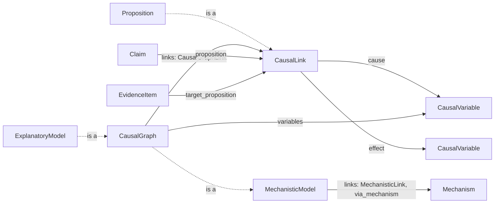

# Causality in DAPPER

**Status:** experimental, 0.3.0-a1. The classes live in `schema/claims.yaml`
(the scientific reasoning layer). `schema/mechanisms.yaml` builds biological
mechanisms on them, `schema/scm.yaml` builds structural causal models on
them, and `schema/dismech.yaml` maps DISMECH onto them.

## What "causes" means here

DAPPER uses one definition of causation throughout, the interventionist one:

> **X causes Y in context C** when some intervention that changed X, with
> other relevant variables held fixed, would change Y (its value or its
> distribution) in C.

This is the counterfactual account of Woodward (2003): the counterfactuals are
about interventions, stated for populations. Four commitments follow.

- **What is related are variables, not bare entities.** A variable is an
  entity together with the aspect of it that varies: CLCN5 *activity*,
  endosomal acidification *rate*, low-molecular-weight proteinuria
  *presence*. "CLCN5 causes Dent disease" is elliptical; what an intervention
  changes is CLCN5 activity. Loss of function is an intervention on that
  variable (setting it low), not part of the variable.
- **It holds in a context.** A dependence holds over some range of settings
  (ancestry, trait, tissue, cell type). That range is the proposition's
  `contexts` and `scope`.
- **It is general by default.** A causal proposition is about a population.
  "This variant caused this patient's disease" is a single-case
  counterfactual and is out of scope for now.
- **"Causal" belongs to content, never to evidence.** A proposition is causal
  because of what it says. A Mendelian randomization result does not make a
  proposition causal; it is evidence for one. How close the evidence comes to
  an intervention is recorded on the evidence (`EvidenceItem.evidence_design`).

The definition handles loss of function, which is causation by absence:
nothing is transmitted from an absent protein, but changing its activity
still changes the effect. It also fits how genetics argues, since knockouts and
CRISPR screens are interventions and loss-of-function carriers and Mendelian
randomization are natural experiments.

Variables in one causal graph must not be related by definition. Dent disease
is *defined* by its proximal-tubule dysfunction, so "proximal-tubule
dysfunction causes Dent disease" is not a causal link between distinct
variables. The [Dent example](#worked-example-dent-disease) ends at
low-molecular-weight proteinuria for that reason.

## Relation kinds

`Proposition.relation_kind` says what kind of dependence a proposition
asserts. Only `CAUSATION` carries the interventionist reading, and a
rendering uses causal language only for it.

| Value | Content | Example |
|---|---|---|
| `ASSOCIATION` | Co-variation, with no claim about interventions. | Gene A is associated with Trait T. |
| `PREDICTION` | Predicts under a stated model. | GeneSet B predicts trait-relevant genes for T. |
| `MEASUREMENT` | Reads out or indicates. | GeneSet B is a possible readout of Factor C. |
| `CONSTITUTION` | Is a component of the mechanism that makes up. | The CLC-5 exchanger is a component of the endosomal acidification machinery. |
| `CAUSATION` | Interventionist dependence. | CLCN5 activity increases endosomal acidification. |

`CAUSATION` close-matches RO's *causally related to* (`RO:0002410`).
Constitution is not causation: parts do not cause the wholes they make up.

## Classes



- **`CausalVariable`**: `description` (required), optional `entity` (a gene,
  process, cell type, phenotype or disease identifier) and `aspect` (what
  varies, from `AspectEnum`: `ACTIVITY`, `ABUNDANCE`, `EXPRESSION`,
  `LOCALIZATION`, `STABILITY`, `STRUCTURE`, `RATE`, `PRESENCE`, `SEVERITY`).
- **`CausalLink`**, a kind of `Proposition`: `cause`, `effect`, and three
  controlled fields: `causal_relation` (which dependence), `effect_direction`
  (which way) and the inherited `relation_kind`, always `CAUSATION`. It also
  inherits `statement`, `contexts` and `scope`. Because a link is a
  Proposition, Claims assess it and EvidenceItems target it **one link at a
  time**. `INCREASES` and `DECREASES` close-match RO's *causally upstream of,
  positive effect* (`RO:0002304`) and *negative effect* (`RO:0002305`).
- **`CausalGraph`**, a kind of `ExplanatoryModel`: an explicit `variables`
  set, `links` (each a `CausalGraphLink`: the link, its `link_type`, and any
  `intermediates`), optional `has_feedback`, `contexts` and `scope`.
- **`MechanisticModel`** (mechanisms.yaml), a kind of `CausalGraph` whose
  links are `MechanisticLink`s that may name the `Mechanism`s carrying them
  out (`via_mechanism`). "Carried out by" is a part-whole relation, not a
  further causal step.

A Proposition, ScientificAccount or EvidenceItem refers to a graph through its
`explanatory_model` slot, which accepts any `ExplanatoryModel`.

## Causal relations

`CausalLink.causal_relation` says which kind of dependence a link asserts,
independent of its sign and of its directness in a graph:

| Value | Meaning | Example |
|---|---|---|
| `CAUSES` | Changing the cause is enough to change the effect in the context; the main difference-maker. | Reduced PT reabsorption causes LMW proteinuria. |
| `CONTRIBUTES_TO` | One difference-maker among several; shifts the effect's value or probability. | A risk variant contributes to disease risk. |
| `ENABLES` | A permissive, necessary condition that does not itself drive the effect's level. | Endosomal acidification enables receptor recycling and reabsorption. |
| `REGULATES` | Graded, specific control: the effect's level tracks the cause's (close to RO's *regulates*, `RO:0002211`). | X regulates M activity. |

"Prevents" is not a separate value. It is a link whose `effect_direction` is
`DECREASES`, so sign and kind of dependence stay independent. Omitting
`causal_relation` says only that the cause makes some difference.

## Directness is relative to a graph

An edge in a causal graph means the cause is a **direct cause of the effect
relative to the graph's variables**: no other variable in the graph lies
between them. So directness is not a property of the link. It is recorded on
the link's place in a graph (`CausalGraphLink.link_type`):

| `link_type` | Meaning in this graph |
|---|---|
| `DIRECT` | No omitted intermediates at this granularity. |
| `INDIRECT_KNOWN_INTERMEDIATES` | Known intermediates are left out; list them in `intermediates`. |
| `INDIRECT_UNKNOWN_INTERMEDIATES` | Intermediates are left out and not known. |
| `UNKNOWN` | Not determined. |

One CausalLink keeps one identifier in every graph that uses it, and can be
`DIRECT` in a coarse graph and `INDIRECT_KNOWN_INTERMEDIATES` in a finer one.
Alternative models that share a step share the link, and so its evidence.

## Feedback

A causal graph is a DAG unless it says otherwise. `has_feedback: true`
declares that the graph contains a directed cycle; a cycle in a graph without
it is an error, and `has_feedback` on an acyclic graph is also an error. Tools
that need a DAG (most causal-effect identification does) can rely on any graph
without `has_feedback`. Feedback is real biology. In a local DISMECH
checkout (2,864 disease files with causal edges), 50 pathographs contain a
loop when all their edges are taken together. Projected as one model per
hypothesis group plus one for edges in no group, 43 diseases have at least
one model with a loop, such as plaque formation and neuroinflammation
reinforcing each other in the amyloid cascade model of Alzheimer disease.

## Structural causal models

`schema/scm.yaml` adds `StructuralCausalModel`, a `CausalGraph` (its causal
diagram) with the functional and probabilistic content of a structural causal
model:

- **`variable_specifications`**: one entry per variable, with its `domain`
  (`BINARY`, `CATEGORICAL`, `ORDINAL`, `CONTINUOUS`, `COUNT`), `levels` or
  `unit`, and `observed: false` for a latent variable. A variable with no
  causes in the model gets a `distribution` (family and parameters). Domains
  live on the model's entry, not the variable, so one CausalVariable can be
  binary in one model and continuous in another and keep one identifier.
- **`equations`**: one `StructuralEquation` for each variable with causes,
  with a `functional_form`, an `expression`, `parameters` and a `noise`
  distribution. Its `inputs` must be exactly the variable's causes in the
  graph.
- **Unmeasured common causes** are explicit latent variables with ordinary
  causal links, so every edge in the model is a CausalLink.
- **Acyclic.** An SCM may not set `has_feedback`; cyclic SCMs need extra
  solvability assumptions.
- **Fitted models** are their own records, generated by the fitting Activity
  and derived (`was_derived_from`) from the model they fit.

A **`CausalEstimand`** is a Proposition naming a causal quantity in a model:
its `estimand_kind` (`AVERAGE_EFFECT`, `CONDITIONAL_AVERAGE_EFFECT`,
`CONTROLLED_DIRECT_EFFECT`, `NATURAL_DIRECT_EFFECT`,
`NATURAL_INDIRECT_EFFECT`), `treatment`, `outcome`, optional `mediator`, the
`interventions` that define the contrast (`do(X = 1)` against `do(X = 0)`),
and the `effect_scale`. Its model is the inherited `explanatory_model`.
Average and controlled direct effects are defined by interventions alone;
natural direct and indirect effects are nested counterfactuals (the mediator
is held at the value it would take under the other treatment), which the SCM
defines but experiments alone cannot identify. All are population averages. An
estimate is a Claim on the estimand with an `EFFECT_ESTIMATE` score, so
estimates from different data or methods assess the same estimand.
`examples/example_structural_causal_model.yaml` is a synthetic mediation
model with a latent confounder and one illustrative estimate.

## Evidence design

`EvidenceItem.evidence_design` records how the evidence was obtained,
relative to the intervention a causal proposition is about:

| Value | Meaning |
|---|---|
| `EXPERIMENTAL_INTERVENTION` | The investigator set the cause (knockout, CRISPR, drug, randomized trial). |
| `NATURAL_EXPERIMENT` | Nature set the cause as-if at random (Mendelian randomization, loss-of-function carriers). |
| `OBSERVATIONAL` | Co-variation observed without an intervention. |
| `MECHANISTIC` | Evidence that a linking mechanism exists and operates. |
| `COMPUTATIONAL` | Output of a computational model or prediction. |

### Where the evidence was obtained

A causal link holds in its `contexts` (organism, tissue, cell type, trait).
An EvidenceItem has contexts too: where its evidence was obtained. When they
match the link's, the evidence bears on the link directly; when they differ
(a mouse knockout for a human link, Caco-2 cells for colonic epithelium), it
bears on it by analogy, and that is visible without reading the prose:

```yaml
causal_links:
  - id: dapper:CausalLink.fosl2-migration
    statement: FOSL2 activity increases colonic epithelial cell migration.
    relation_kind: CAUSATION
    cause: dapper:CausalVariable.fosl2-activity
    effect: dapper:CausalVariable.epithelial-migration
    contexts:
      - {context_type: CellTypeContext, cell_type: "CL:0011108"}   # colon epithelial cell
      - {context_type: OrganismContext, organism: "NCBITaxon:9606"}
evidence_items:
  - id: dapper:EvidenceItem.caco2-scratch
    target_proposition: dapper:CausalLink.fosl2-migration
    evidence_design: EXPERIMENTAL_INTERVENTION
    contexts:
      - {context_type: CellLineContext, cell_line: "cellosaurus:0025"}   # Caco-2
```

(Illustrative ids; real ones are minted.)

### What a claim's direction rests on

A Claim's `direction` says which way the evidence points; its
`evidence_basis` says how close that evidence comes to the proposition's own
contexts. They are separate because they fail separately: a link shown in
mouse colon and a link contradicted in human colon differ in basis, not only
in sign.

| `evidence_basis` | The direction rests on |
|---|---|
| `IN_CONTEXT` | Evidence obtained in the proposition's own contexts. |
| `BY_ANALOGY` | Direct evidence from other contexts only: another organism, a cell line, another cell type or tissue. |
| `INDIRECT` | Evidence about neighbouring propositions (an upstream or downstream link, an association). |
| `UNTESTED` | Nothing. Absence of evidence, recorded as a finding; no direction, or `UNKNOWN`. |

With mixed evidence, the basis is the strongest among the items that carry
the claim's direction. The evidence items' `contexts` let a reader check it.

## Genetic variants

`genetics.yaml` puts variants into the same causal terms. A
`GenotypeVariable` is allele dosage at a dbSNP variant: the number of copies
of its `effect_allele`. A link from it says what adding a copy does, so its
`effect_direction` and any estimate follow the effect allele.

What a study reports and what an account concludes stay separate:

- a **`GeneticAssociation`** (relation kind `ASSOCIATION`) is the study's
  result: the genotype co-varies with an `associated_variable` (a disease or
  trait, `DISEASE_OR_TRAIT`; or a gene's expression in a tissue, `EQTL`, and
  the other QTL kinds) in its contexts. A Claim on it carries a
  **`GeneticEffectEstimate`**: the estimate on its `effect_scale` (beta as
  `DIFFERENCE`, log odds ratio, normalized effect size as
  `STANDARDIZED_DIFFERENCE`), with standard error, p-value and sample size,
  and how it was obtained: `study_scope` (`GENOME_WIDE` or `CANDIDATE_GENE`),
  `meta_analysis` with `number_of_studies`, and case and control counts;
- a **CausalLink from the GenotypeVariable** (genotype → expression) is the
  causal reading, written only when the account needs that step. Its
  evidence cites the association Claims, with design `NATURAL_EXPERIMENT`,
  and says what licenses the causal reading (fine-mapping, colocalization,
  allele-specific expression, editing). An associated variant may only tag
  the causal one.

## Rival hypotheses and discriminating experiments

Competing mechanisms are separate Propositions, each with its own model.
An account frames each as a Hypothesis; a rival names the one it competes
with in `alternative_to`. Claims then assess each one's links.

A `DiscriminatingExperiment` (scm.yaml), listed in an account's
`proposed_experiments`, says how to tell rivals apart in interventionist
terms:

- `estimands`: CausalEstimands, each the effect of setting a treatment
  (`interventions`: value against reference) on an outcome;
- `instruments`: variables that shift a treatment the investigator cannot
  set, such as a GenotypeVariable in Mendelian randomization;
- `predictions`: for each tested proposition, holding or failing
  (`proposition_holds`), what each estimand will show: `INCREASES`,
  `DECREASES`, `NO_CHANGE` or `CHANGES`;
- `contexts` (the experimental system), `tests` and `addresses_gaps`.

The check requires at least one estimand on which two predictions differ;
otherwise the experiment does not discriminate.
`examples/example_genetic_discriminating_account.yaml` shows an eQTL, a
causal link read from it, two rival hypotheses, an untested link recorded as
a gap, and a knockout that discriminates the hypotheses.

## What is not causal

PROV relations (`prov:wasGeneratedBy`, `prov:wasDerivedFrom`, `prov:used`)
record how an artifact was produced. They are not causal claims about
biology and are not read as interventionist dependences. Neither is
membership in a ScientificAccount, or the order of its claims.

## Checks

`tools/scientific_claims.py` (also run by the provenance linter) checks that
every graph link names a CausalLink, that its cause and effect are in the
graph's `variables`, that a link appears once per graph, and that cycles
match `has_feedback`. For an SCM it also checks one specification and one
equation per variable, equation inputs against the graph, distributions only
on uncaused variables, and acyclicity; for an estimand, that its variables
belong to its model and that a direct or indirect effect names a mediator.
For a DiscriminatingExperiment it checks that predictions use its own
estimands and tested propositions, that two of them differ on one estimand,
and that no instrument is an estimand's treatment or outcome. A
GeneticEffectEstimate must assess a proposition about a GenotypeVariable,
and an `UNTESTED` claim takes no direction. JSON Schema rejects a CausalLink whose `relation_kind`
is not `CAUSATION`, and `via_mechanism` outside a MechanisticModel.

## Worked example: Dent disease

`examples/example_claim_provenance_trace.yaml` holds the model as four
variables and three links:

| Cause | Effect | Direction | In the graph |
|---|---|---|---|
| CLCN5 activity (`HGNC:2023`) | Endosomal acidification (`GO:0048388`) | increases | `DIRECT` |
| Endosomal acidification | PT reabsorption of LMW proteins | increases | `INDIRECT_KNOWN_INTERMEDIATES` (megalin/cubilin recycling) |
| PT reabsorption of LMW proteins | LMW proteinuria (`HP:0003126`) | decreases | `DIRECT` |

Loss of CLCN5 function lowers the first variable, and the signs carry it
through: less acidification, less reabsorption, more proteinuria. The
proposition that references the model, "Loss-of-function variants in CLCN5 …
manifests as Dent disease", has `relation_kind: CAUSATION`.

## DISMECH

DISMECH calls a disease's causal graph its pathograph. `tools/dismech_pathograph.py`
projects one onto DAPPER and back (the mapping table is in
`schema/dismech.yaml`): nodes become CausalVariables, CausalEdges become
CausalLinks, and each hypothesis group becomes a MechanisticModel. All 2,948
disease files in a local DISMECH checkout round-trip with identical edge
sets. DISMECH does not define its edges as interventionist, so the
correspondence is close, not exact. Edge evidence is not projected yet.

```sh
uv run tools/dismech_pathograph.py import path/to/dismech/kb/disorders/Alzheimer_Disease.yaml
uv run tools/dismech_pathograph.py roundtrip path/to/dismech/kb/disorders/*.yaml
```
